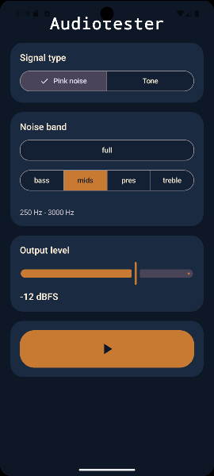
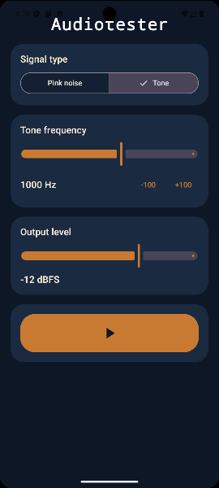

# Audiotester

Audiotester is a simple Android signal generator for testing audio devices.
It is designed to send audio over normal Android media output paths such as Bluetooth speakers, headphones, DACs, or other paired playback devices.

I am using the app with a cheap bluetooth receiver that is connected to the device under repair.

The app provides:

- Pink noise playback
- Five selectable noise bands: full, bass, mids, presence, treble
- Sine wave test tone generation with variable frequency
- Parametric EQ for pink noise: peak/dip, low shelf, and high shelf filters
- Named headphone EQ presets and a copyable parameter sheet


The pink noise generator with four bands:



Sine wave generator:



## Requirements

- Android Studio
- Android SDK installed through Android Studio
- JDK 17
- Android device running Android 8.0 (API 26) or newer, or an emulator for basic UI checks

## Project structure

- `app/src/main/java/com/audiotester/`
  Android app source code
- `app/src/main/java/com/audiotester/AudioEngine.kt`
  Real-time audio generation for pink noise and sine tones
- `app/src/main/java/com/audiotester/MainActivity.kt`
  Jetpack Compose UI

## Build in Android Studio

1. Open Android Studio.
2. Open the project folder:
   `E:\proj\audiotester`
3. Let Gradle sync the project.
4. If Android Studio asks to install missing SDK components, allow it.
5. Select a device and run the `app` configuration.

## Install on a physical Android device

1. Enable Developer Options on the phone.
2. Enable `USB debugging`.
3. Connect the device over USB.
4. Accept the debugging prompt on the phone.
5. In Android Studio, select the device and press Run.

Android Studio will build and install the debug app automatically.

## Build an APK

To build a debug APK in Android Studio:

1. Open `Build > Build Bundle(s) / APK(s) > Build APK(s)`.
2. Wait for the build to finish.
3. Open the generated APK from the build notification.

## Usage

1. Pair and connect your Bluetooth audio device in Android settings.
2. Start Audiotester.
3. Choose either `Pink noise` or `Tone`.
4. For pink noise, select `bass`, `mids`, or `treble`.
5. For tone mode, adjust the frequency slider.
6. Set output level conservatively before starting playback.
7. Press the play button to start output.

## Pink-noise equalizer

In pink-noise mode, open **Edit equalizer**. The EQ starts with five flat bands.
Use the Android Back button or gesture to leave the editor.
Select a solid-colored numbered band or tap its marker on the response graph; the
selected band's gain, frequency, and Q appear inside the graph. Choose **dB**, **Hz**,
or **Q** using the round buttons inside the fan scale; the selected button is white.
Then drag the line indicator. Frequency and
Q use logarithmic scales. The limits are ±15 dB, 20–20,000 Hz, and Q 0.1–10.

Change the selected band's filter type using the borderless dropdown inside the scale,
above the parameter buttons. The selected band's button
shows a down-arrow; tap it again to open its enable/disable and delete menu. Tapping
an unselected band selects it without opening a menu. Add bands with **+**.
The global switch bypasses all EQ filters; tone generation is unaffected. The existing noise-band
selection still applies, so select **full** when adjusting EQ across the full spectrum.

Tap the preset-name dropdown (or **Save EQ preset** for an unsaved EQ) to open the
**Equalizer presets** menu. **Create EQ preset** saves the current EQ under a name;
choosing an existing name offers **Replace**. **Save changes to current preset** updates
the selected preset after confirmation. Tap a saved preset to load it, or use its
**…** menu to replace it with the current EQ or delete it. Deleting a preset keeps
the current settings. **Reset to default** restores five flat bands and keeps saved
presets. Edits persist automatically without overwriting saved presets until you
explicitly save again. Presets and the current EQ survive app restarts.

**Sheet** summarizes all bands, including disabled bands, and the global EQ state.
**Copy** puts tab-separated text on the clipboard.

EQ applies the configured band gains directly. Shelf Q controls resonance, so higher Q
may overshoot the shelf gain. The graph shows the combined EQ curve and expands its
vertical range when needed. Filter edits and bypass changes crossfade over approximately 43 ms;
the output clamp remains a final safeguard against transient peaks.

The filter coefficients follow the [W3C Audio EQ Cookbook](https://www.w3.org/TR/audio-eq-cookbook/).

## Verification

From PowerShell, with Android Studio's bundled JDK and the Android SDK configured:

```powershell
$env:JAVA_HOME = 'E:\Programs\Android Studio\jbr'
.\gradlew.bat :app:assembleDebug :app:testDebugUnitTest :app:lintDebug
```

The debug APK is written to `app/build/outputs/apk/debug/app-debug.apk`.
Unit tests cover filter response, stability at the parameter limits, combined boost gain,
bypass transitions, preset persistence, and clipboard text formatting. Device interaction
and listening checks are performed separately in Android Studio/on the phone.

## Audio routing

- Bluetooth pairing and routing are handled by Android, not by the app.
- The app uses standard media playback routing via `AudioTrack`.
- For reliable external audio tests, use a physical device rather than an emulator.

## License

This project is licensed under the MIT License. See `LICENSE`.
